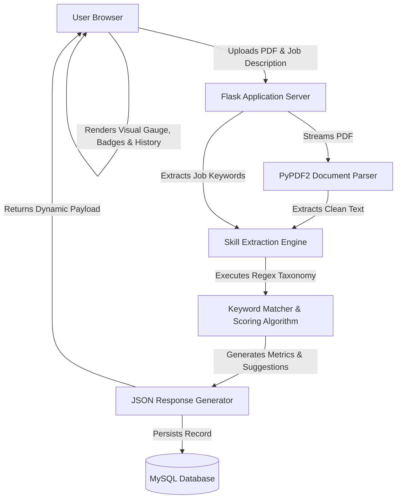

# AI-Powered Resume Analyzer

An intelligent, full-stack web application built with **Python, Flask, Bootstrap 5, JavaScript, PyPDF2**, and **MySQL**. The application automates resume text extraction, evaluates candidate skills against real-world job requirements using regular expression keyword matching, calculates a normalized **Skill Match Percentage**, and provides targeted recommendations to help candidates optimize their resumes for applicant tracking systems (ATS).

---

## 📌 Problem Statement

In modern hiring workflows, candidate resumes are routinely processed by Applicant Tracking Systems (ATS) and talent acquisition software. Job seekers frequently face challenges such as:
- **Keyword Blindspots:** Missing critical technical skills explicitly demanded by job specifications despite having relevant project experience.
- **Ambiguous Alignment:** Lacking visibility into how well their resume matches a specific target job role prior to applying.
- **Unclear Improvement Pathways:** Not knowing which technical gaps to bridge or how to position their skills effectively.

---

## 🎯 Project Objectives

1. **Automated Document Processing:** Parse and extract clean plain text from uploaded PDF resumes in-memory without altering document integrity.
2. **Intelligent Keyword Matching:** Identify technical skills across multiple domains (Programming, Web, Backend, Cloud, Databases, AI/ML) using case-insensitive regular expressions with word boundary precision.
3. **Skill Gap & Benchmark Analysis:** Calculate an accurate, objective **Skill Match Percentage** contrasting required job qualifications with the candidate's verified skills.
4. **Actionable Career Guidance:** Automatically generate tailored improvement tips to highlight missing skills, quantify achievements, and improve recruiter appeal.
5. **Persistent Analysis Tracking:** Maintain an audit trail of all resume evaluations in a relational MySQL database with an interactive history viewer.

---

## ✨ Features

- **Intuitive Modern Dashboard:** Designed with a professional navy blue, crisp white, and light blue palette featuring card elevations, hover states, and responsive layouts.
- **Drag-and-Drop PDF Upload:** Streamlined resume file picker supporting drag-and-drop, real-time file size indicators, and format validation.
- **Instant Job Benchmark:** Large interactive job description input with a built-in live word counter and 1-click **"Load Sample"** testing.
- **Dynamic Asynchronous Processing:** Submits files and displays a loading spinner via the browser's `fetch()` API without page reloads.
- **Visual Score Gauge:** Animated circular conical progress gauge with color-coded ratings:
  - 🟢 **High Match ($\ge 80\%$):** Strong alignment with role requirements.
  - 🟡 **Moderate Match ($50\% - 79\%$):** Solid foundation with addressable skill gaps.
  - 🔴 **Needs Optimization ($< 50\%$):** Noticeable keyword and technology gaps.
- **Skill Breakdown Badges:**
  - **Matched Skills:** Emerald green badges highlighting technologies shared between resume and job description.
  - **Missing Skills (Skill Gaps):** Soft red badges identifying skills specified in the job description that were absent from the resume.
- **Collapsible Resume Inspector:** View the raw text extracted from your PDF to verify parsing fidelity.
- **Historical Analysis Vault:** Full history table tracking past analyses with timestamps, scores, and an expandable detail modal.
- **Robust Security & Privacy:** Database credentials strictly managed via `.env` and excluded from Git; files processed in-memory.

---

## 🛠️ Technologies Used

| Layer | Technology | Purpose |
| :--- | :--- | :--- |
| **Frontend** | HTML5, CSS3, JavaScript (ES6+) | UI structure, custom responsive styles, and interactive asynchronous DOM manipulation |
| **UI Framework** | Bootstrap 5.3 & Bootstrap Icons | Responsive grid system, typography, cards, badges, and modals |
| **Web Server / Backend**| Python 3 & Flask 3 | RESTful routing, multipart upload validation, and template serving |
| **Document Parsing** | PyPDF2 (v3.0+) | In-memory PDF text extraction and encoding normalization |
| **Analysis Engine** | Python Regex (`re`) | Case-insensitive keyword extraction across curated technical taxonomy |
| **Database** | MySQL 8.0 & PyMySQL | Relational schema storing analysis records, match metrics, and timestamps |
| **Environment Config** | `python-dotenv` | Secure environment variable configuration via `.env` |

---

## 🏗️ System Architecture



---

## 📂 Project Folder Structure

```text
AI_Resume_Analyzer/
│
├── .env                  # Environment variables (Credentials - git-ignored)
├── .env.example          # Template for required environment variables
├── .gitignore            # Git configuration ignoring venv, .env, and caches
├── analyzer.py           # Core text extraction and regex skill matching engine
├── app.py                 # Main Flask server entry point and API route handlers
├── db.py                 # MySQL database connector, table initialization, and queries
├── requirements.txt      # Production package dependencies
├── sample_resume.pdf     # Built-in sample PDF resume for immediate testing
│
├── static/
│   ├── script.js         # Client-side AJAX requests, drag-and-drop, and DOM updates
│   └── style.css          # Custom styling, color variables, circular gauge, and badges
│
└── templates/
    └── index.html        # Main dashboard interface with Bootstrap 5
```

---

## ⚙️ Installation & Setup Instructions

### 1. Prerequisites
Ensure you have the following installed on your operating system:
- **Python 3.10+** (Python 3.14 recommended)
- **MySQL Server 8.0+** & **MySQL Workbench**
- **Git**

### 2. Clone the Repository
```bash
git clone https://github.com/your-username/AI_Resume_Analyzer.git
cd AI_Resume_Analyzer
```

### 3. Create and Activate Virtual Environment
On Windows (PowerShell):
```powershell
python -m venv venv
.\venv\Scripts\Activate.ps1
```

On macOS / Linux:
```bash
python3 -m venv venv
source venv/bin/activate
```

### 4. Install Dependencies
```bash
pip install -r requirements.txt
```

---

## 🗄️ MySQL Database Setup

1. Open **MySQL Workbench** (or your preferred MySQL client) and connect to your local MySQL server.
2. Create the database and dedicated user:
   ```sql
   CREATE DATABASE IF NOT EXISTS ai_resume_analyzer CHARACTER SET utf8mb4 COLLATE utf8mb4_unicode_ci;

   -- Optional: Create dedicated user (or use existing user)
   CREATE USER IF NOT EXISTS 'resume_user'@'localhost' IDENTIFIED BY 'your_password_here';
   GRANT ALL PRIVILEGES ON ai_resume_analyzer.* TO 'resume_user'@'localhost';
   FLUSH PRIVILEGES;
   ```
3. Copy `.env.example` to create your private `.env` file:
   ```bash
   cp .env.example .env
   ```
4. Open `.env` and fill in your MySQL credentials:
   ```env
   DB_HOST=localhost
   DB_PORT=3306
   DB_USER=resume_user
   DB_PASSWORD=your_password_here
   DB_NAME=ai_resume_analyzer
   FLASK_SECRET_KEY=super-secret-key-change-me
   ```
5. The application will automatically create the `analyses` table on its first connection.

---

## 🚀 Running the Application

1. Make sure your virtual environment is active:
   ```powershell
   .\venv\Scripts\Activate.ps1
   ```
2. Start the Flask server:
   ```powershell
   python app.py
   ```
3. Open your browser and navigate to:
   ```text
   http://127.0.0.1:5000
   ```

---

## 🖼️ Application Preview & Workflow

### 1. Welcome & Analyzer Workspace
- **Hero Section:** Clean banner introducing the application with an animated **"Get Started"** button.
- **Upload Dropzone:** Drag and drop your resume (`.pdf` up to 16 MB).
- **Job Description Area:** Enter custom job requirements or click **"Load Sample"** for instant testing.

### 2. Analysis Report
- **Conical Score Indicator:** Shows the exact Skill Match Percentage.
- **Matched & Missing Skills:** Interactive pill badges categorizing competencies.
- **Tailored Suggestions:** Guidance on missing keywords, bullet point phrasing, and quantitative metrics.
- **Extracted Text Drawer:** Full plain-text audit of the uploaded resume.

### 3. Database History View
- **Live Connection Pill:** Real-time indicator displaying database connectivity.
- **Searchable Record Table:** Shows past evaluations with timestamps and percentages.
- **Detailed Modal:** Click **"View"** on any record to inspect historical job requirements, matched badges, and recommendations.

---

## 🔮 Future Enhancements

- [ ] **AI-Powered Semantic Analysis:** Incorporate Large Language Models (LLMs) via the Gemini API to analyze context, soft skills, and sentence structure beyond keyword matching.
- [ ] **Multi-Format Ingestion:** Add support for Microsoft Word (`.docx`) and plain text (`.txt`) resumes.
- [ ] **Exportable PDF Reports:** Allow users to download a styled PDF report summarizing their skill gaps and recommendations.
- [ ] **User Authentication:** Support individual candidate profiles, password hashing, and private analysis histories using Flask-Login.
- [ ] **Job Recommendation Feed:** Suggest active open positions matching candidate skill profiles.

---

## 📄 License & Credits

Distributed under the MIT License. Developed as a modern full-stack web project.

